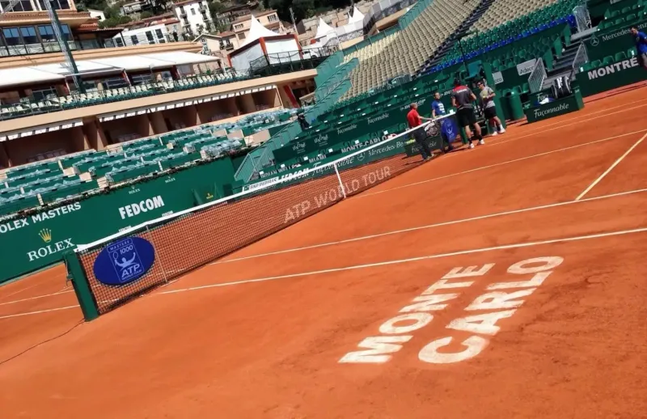
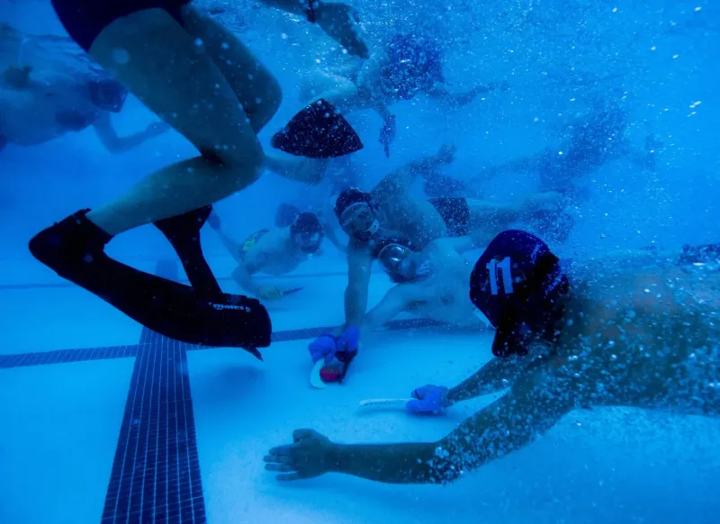
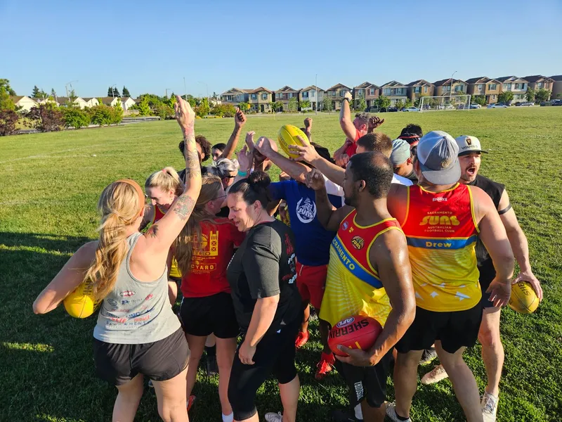
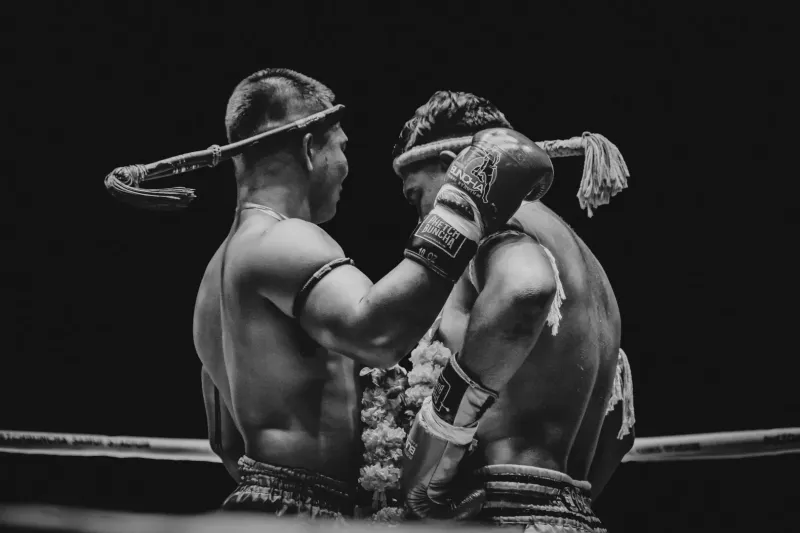
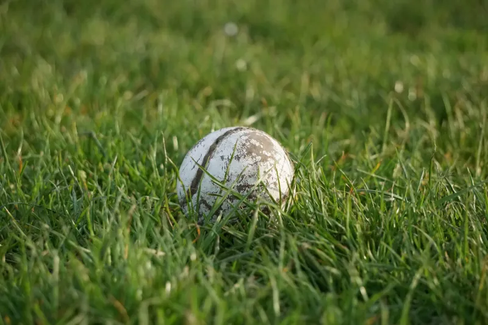
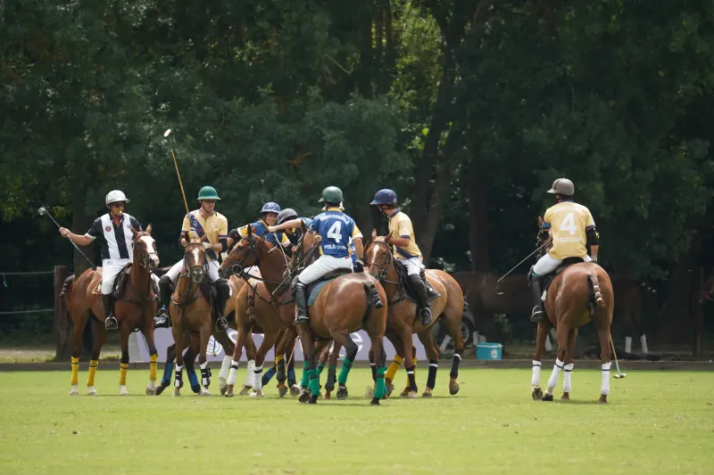

### 1. Tennis in Monaco

Fans honk yacht horns instead of clapping during matches. The ritual began at royal charity events decades ago. Loud echoes bounce off the harbor walls. Players report it as both energizing and annoying.

### 2. Underwater Hockey in Australia

Spectators release colored bubbles from tubes to cheer. This signals support without sound underwater. Teams assign bubble colors for players. It turns the pool surface into a moving light show.

### 3. Kabaddi in Rural Punjab

Villagers wave flaming torches during night games. The flames represent the player's breath hold. Crowds chant in total darkness between raids. Local legends claim it scares away bad luck.

### 4. Sepak Takraw in Thailand

Players tie lucky headbands before each set. They must spin once on the court edge. Failure to spin is said to bring injuries. Crowds count the spins out loud together.

### 5. Hurling in Ireland

Fans throw spare sliotars onto the pitch at halftime. This started as a protest against a referee in 1982. Now it happens in every county final. Groundskeepers collect them in colorful buckets.

### 6. Polo in Argentina

Spectators tie team-colored ribbons on horses during breaks. Horses then parade around the field once. The ritual is believed to transfer fan energy. Losers must remove ribbons before leaving.

