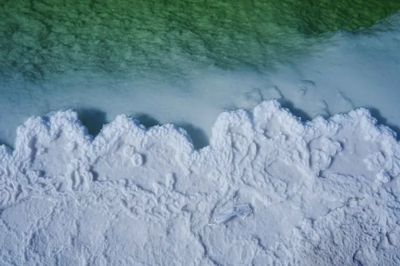
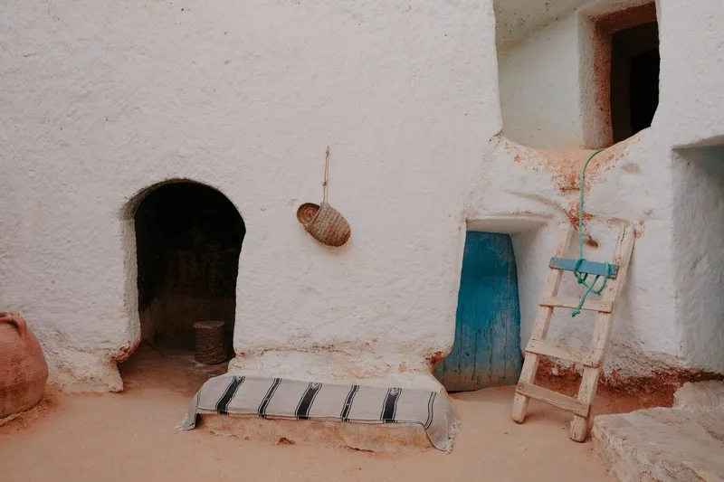
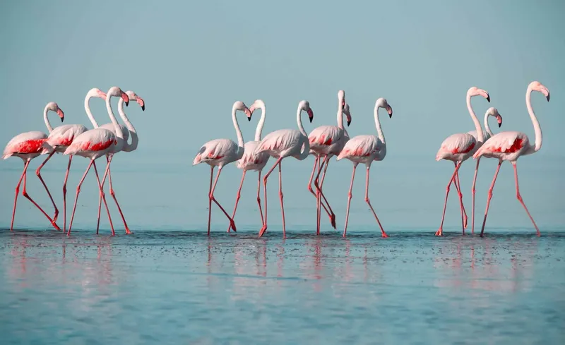
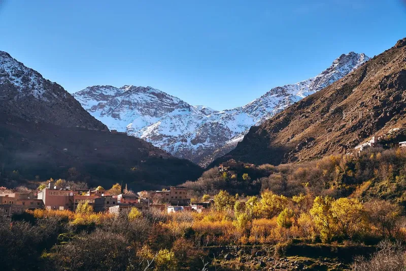
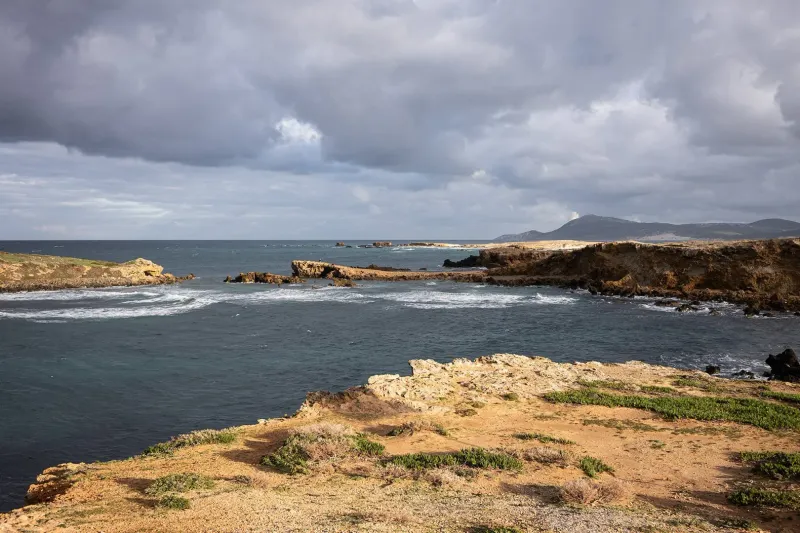
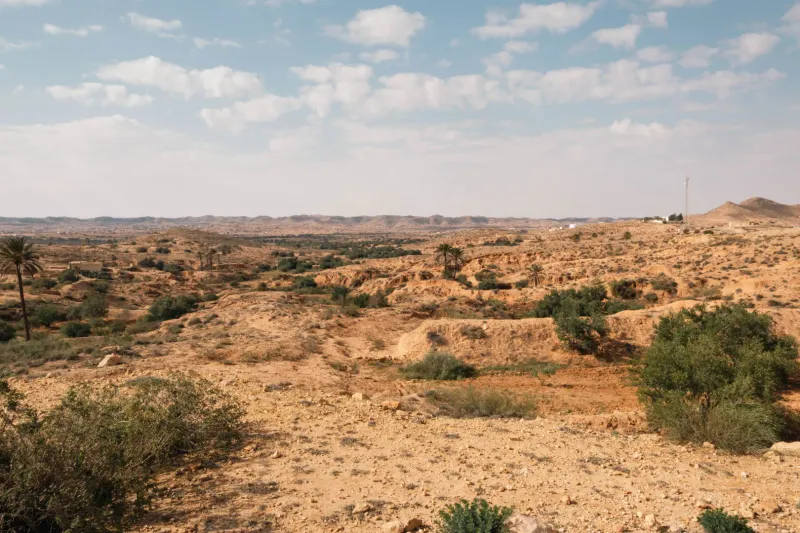

### 1. Chott el Djerid Salt Flat

This large endorheic basin covers over 5000 square kilometers. It floods with shallow water during winter rains. The surface dries into a hard salt crust by summer. Satellite images confirm its reflective white appearance from space.

### 2. Matmata Hills Cave Homes

Berber communities excavated circular courtyard homes into soft sandstone hills. Each home has rooms opening directly from a central pit. Temperatures stay cooler inside than on the surface. These dwellings appear in official Tunisian housing surveys.

### 3. Ichkeul Lake Wetland

The lake connects to the sea through a narrow channel. It supports large populations of wintering ducks and geese. UNESCO lists it as a biosphere reserve. Water salinity changes seasonally with rainfall and sea level.

### 4. Jebel ech Chambi Peak

This summit reaches 1544 meters and is Tunisia's highest point. Aleppo pine forests cover its upper slopes. Marked trails lead to a stone observation tower. Government topographic maps record its exact elevation.

### 5. Ras Angela Cape

This headland marks the northernmost point on the African continent. Limestone cliffs drop directly into the Mediterranean. A lighthouse stands at the tip for navigation. Official geographic institutes list its coordinates as 37°21'N.

### 6. Bouhedma National Park Dunes

The park protects a transition zone between steppe and Sahara. Scattered acacia trees grow on stabilized sand ridges. Gazelle herds graze in fenced sections. Park records document its role in halting desert expansion.

