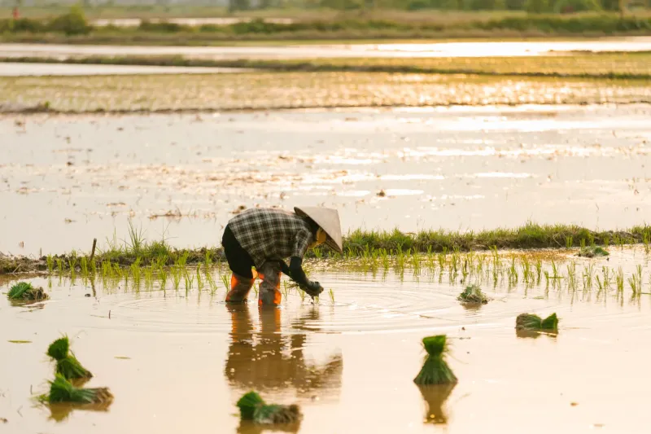
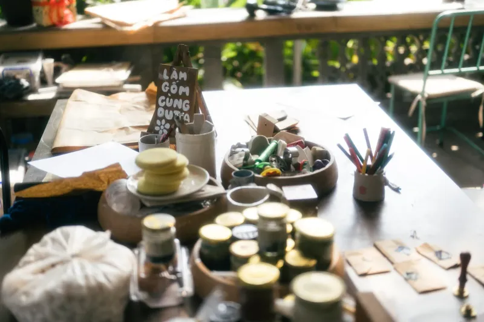

### 1. No se permiten ropas rojas

Los residentes deben evitar las prendas rojas durante la temporada de cosecha. Los ancianos creen que el color atrae espíritus de mal tiempo. Los jóvenes a menudo se cuelan con pequeños accesorios rojos de todos modos. Esto crea una tensión silenciosa entre generaciones.

### 2. Los perros no pueden ladrar después del anochecer

La ley de la aldea multa a los dueños si los perros ladran después de las 10 pm. La regla tiene como objetivo proteger viajes de pesca secretos en el río. Los vecinos reportan violaciones a través de notas anónimas. Muchas familias entrenan a los perros con bozales en su lugar.

### 3. Solo las mujeres pueden plantar el primer arroz

Los hombres tienen prohibido el ritual inicial de plantación de arroz cada año. Los locales dicen que las manos femeninas traen mejor suerte al suelo. Los hombres manejan solo las tareas posteriores de deshierbe y cosecha. La costumbre lleva a discusiones jugosas durante la semana de plantación.

### 4. Quema de dinero fantasma en las bodas

Las parejas deben quemar dinero falso antes de que comience la ceremonia. Las familias afirman que paga los celos ancestrales. La práctica a menudo choca con los planificadores de bodas modernos. Los invitados a veces ocultan la quema de los parientes de la ciudad.

### 5. No espejos frente a las camas

Cada hogar cubre los espejos del dormitorio después del atardecer. Las historias advierten que el vidrio descubierto invita a visitantes espíritus. Los hoteles en la zona proporcionan cubiertas de tela a pedido. Los turistas frecuentemente olvidan y son advertidos por los anfitriones.

### 6. Cepillos de dientes compartidos para la buena suerte

Las parejas recién casadas comparten un cepillo de dientes durante el primer mes. Los ancianos dicen que transfiere buena fortuna entre los socios. El hábito sorprende a los forasteros durante las visitas de homestay. Algunas parejas cambian silenciosamente a cepillos separados.

