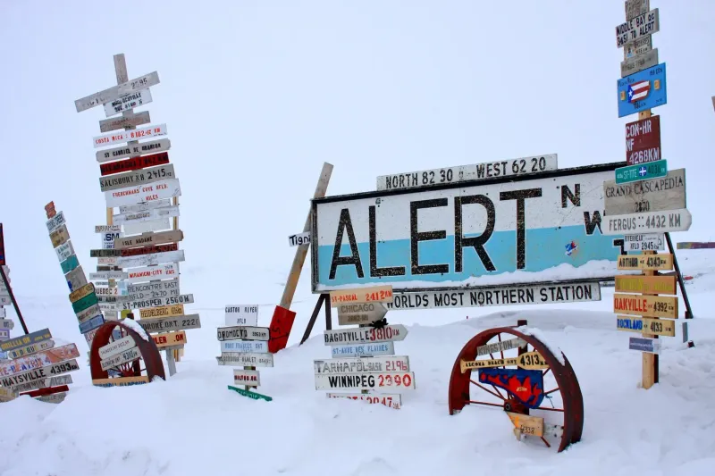
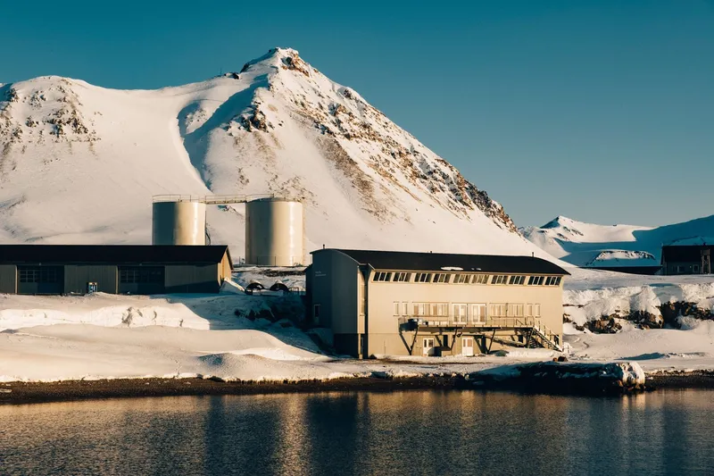
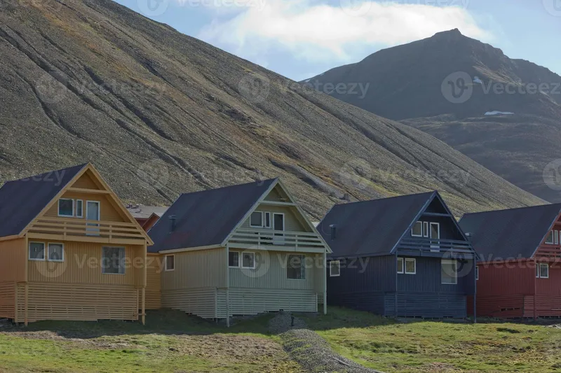
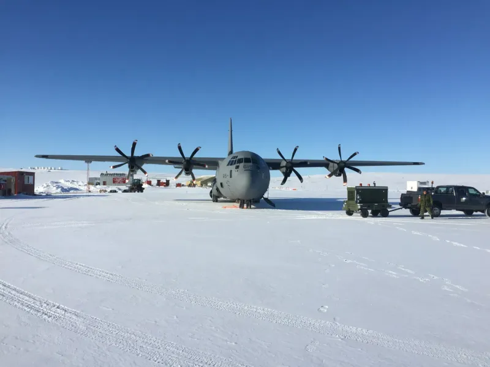
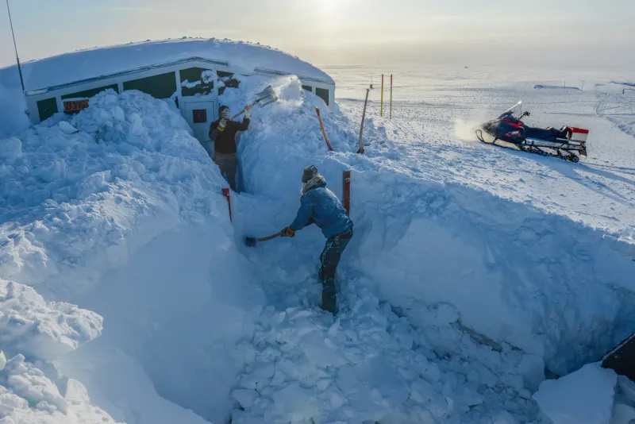
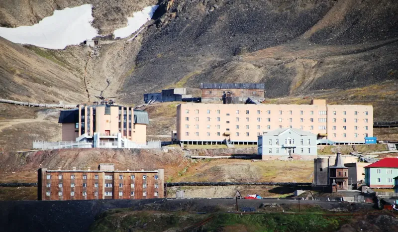

### 1. Alert, Canada

Situé à 82 degrés de latitude nord. Fonctionne principalement comme un avant-poste militaire et météorologique canadien. Accueille moins de 100 personnes toute l'année. Reste coupé des routes et des approvisionnements réguliers pendant des mois.

### 2. Ny-Ålesund, Svalbard

La colonie la plus au nord du monde habitée en permanence. Héberge des stations de recherche polaire internationales. Limite l'accès aux scientifiques et au personnel uniquement. Connaît une lumière continue pendant quatre mois chaque été.

### 3. Longyearbyen, Svalbard

La plus grande ville du Svalbard à 78 degrés nord. Exige que les résidents portent des fusils hors des limites de la ville. Interdit les enterrements en raison des conditions de permafrost. Fonctionne selon des règles uniques de souveraineté norvégienne.

### 4. Resolute, Canada

Petite communauté inuite sur l'île de Cornwallis. Sert de plaque tournante clé pour les vols de recherche arctique. Enregistre des températures hivernales moyennes inférieures à moins 30 Celsius. Maintient une population inférieure à 200 personnes.

### 5. Nord, Greenland

Station militaire et météorologique danoise à 81 degrés nord. Fonctionne avec un personnel tournant d'environ 20 personnes. Reçoit des vols d'approvisionnement seulement quelques fois par an. Situé sur une péninsule libre de glace entourée de glaciers.

### 6. Barentsburg, Svalbard

Colonie minière de charbon russe à 78 degrés nord. Présente une architecture de l'ère soviétique et une petite population. Maintient sa propre école et ses installations culturelles. S'appuie sur les exportations de charbon et le soutien du gouvernement russe.

