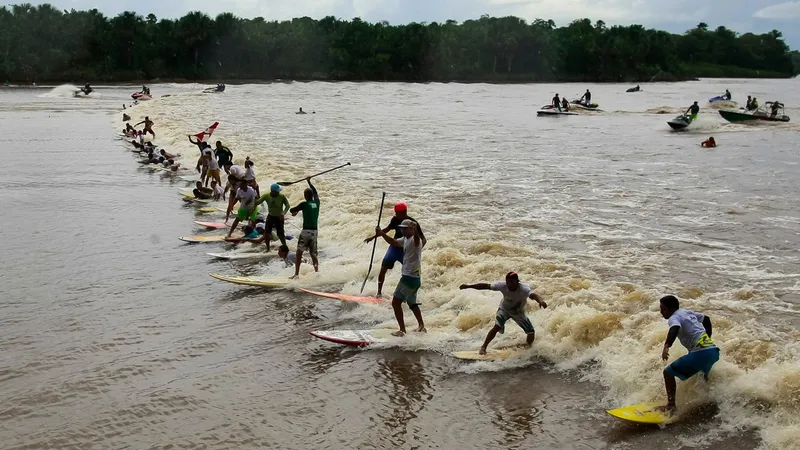
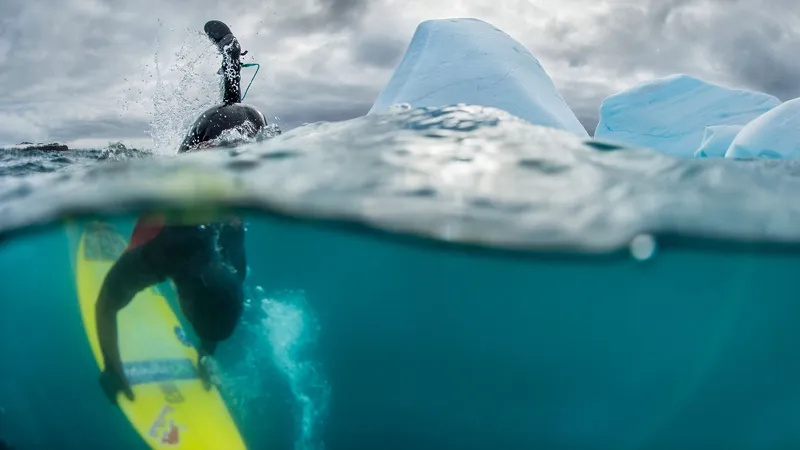
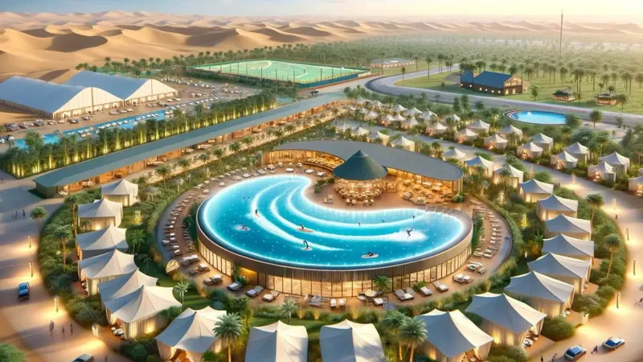
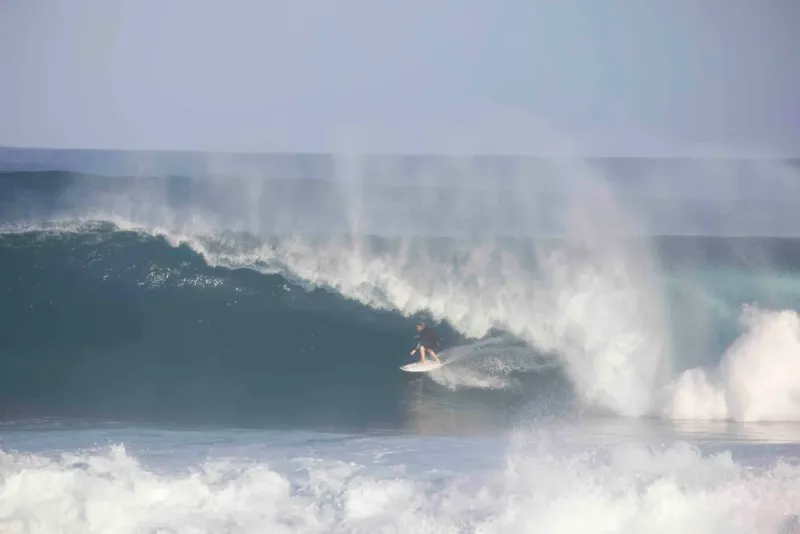
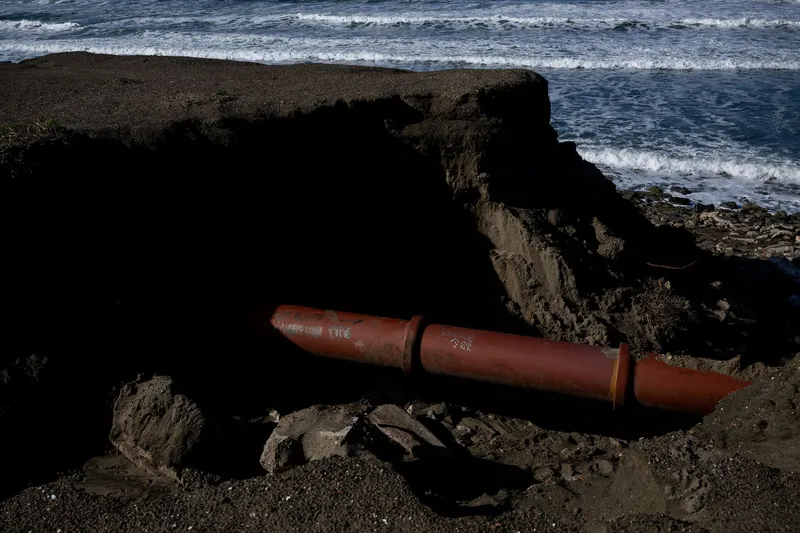
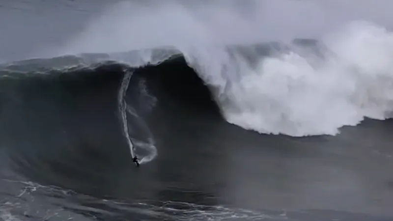

### 1. Valuri pe Râul Amazon

Surferi călăresc valuri staționare create de maree. Râul curge înapoi în timpul mareei înalte. Atrage aventurieri din întreaga lume. Dar apa este tulbure și plină de faună sălbatică.

### 2. Surfing pe Ghețari în Antarctica

Oamenii surfesc între aisberguri în ape reci. Costumul de neopren trebuie să fie extra gros pentru supraviețuire. Valurile sunt puternice din cauza vânturilor puternice. Zvonuri spun că pinguinii privesc de pe mal.

### 3. Piscina cu Valuri din Mallul Dubai

Valuri artificiale în interiorul unui centru comercial de lux. Surferii exersează tot anul în aer condiționat. Provocă normele tradiționale de surf pe plajă. Mulțimi se adună să privească din magazine.

### 4. Lacul din Craterul Vulcanului

Un lac format într-un vulcan stins. Apele calde și curenții unici surprind vizitatorii. Puțini știu despre acest loc ascuns. Combină surfingul cu aventuri de drumeție.

### 5. Valuri la Ieșirea de Canalizare

Valuri se formează lângă ieșirea unei stații de tratare. Surferii susțin că calitatea apei este bună. Acest loc este controversat printre localnici. Oferă valuri puternice dar cu riscuri.

### 6. Surfing în Cariera Inundată

Vechi situri miniere transformate în locuri de surf. Pereții abrupți creează modele unice de valuri. Este popular în unele țări europene. Preocupările de siguranță îl fac o activitate îndrăzneață.

