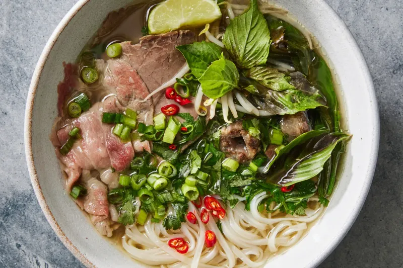
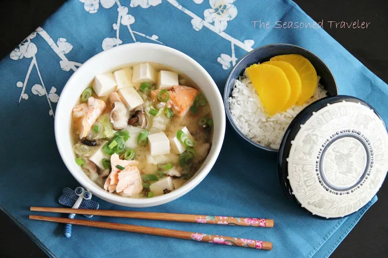
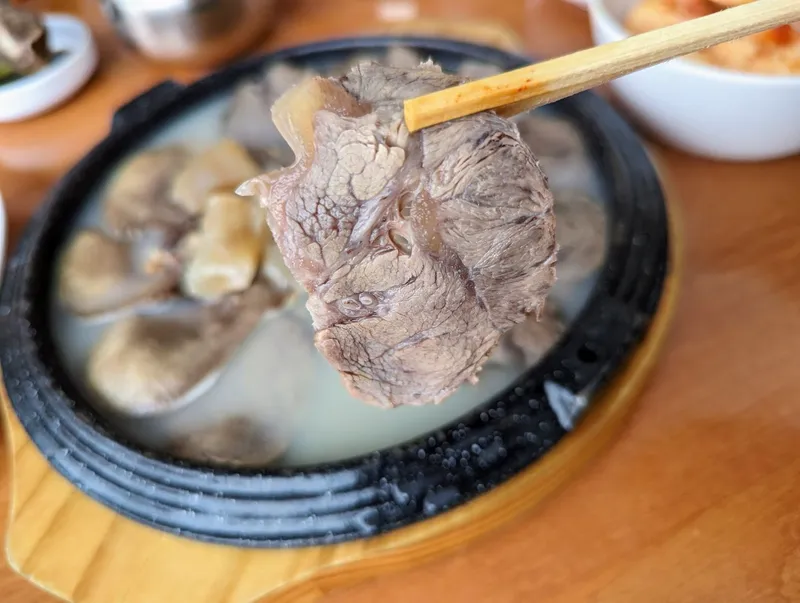
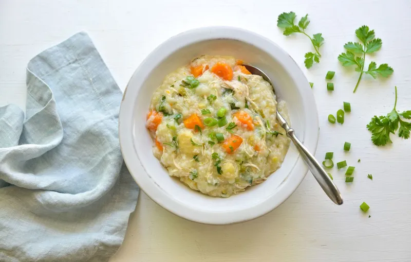
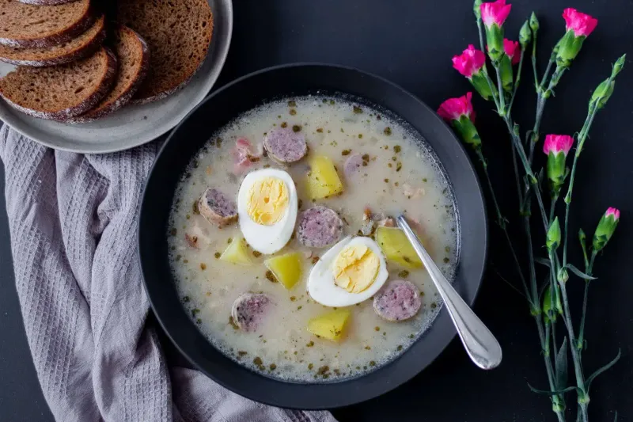
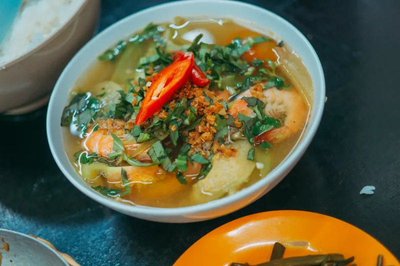
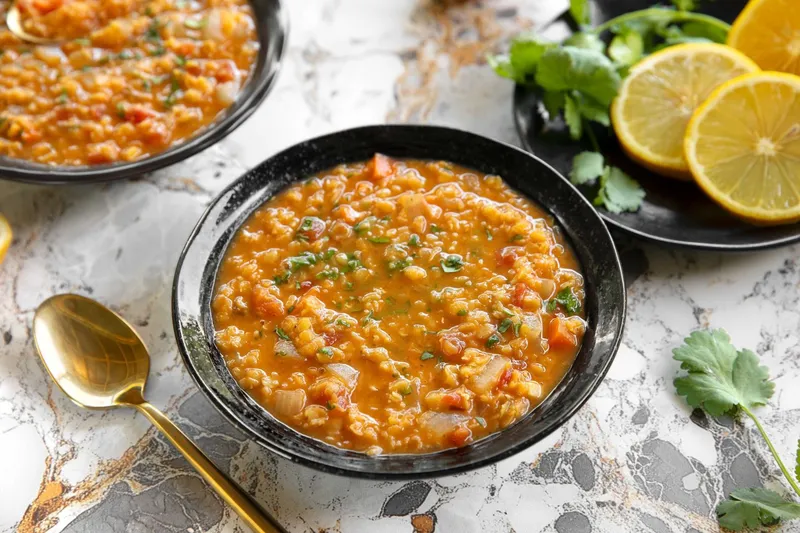

### 1. Pho Vietnamez

Pho este o supă de tăiței cu bulion de vită. Este consumată în mod obișnuit dimineața în Vietnam. Tăiței de orez și ierburi proaspete sunt adăugate la masă. Vânzătorii ambulanți o servesc fierbinte de dimineață devreme.

### 2. Supă Miso Japoneză

Supa miso începe ziua în multe case japoneze. Conține pastă de soia fermentată și supă dashi. Tofu sau alge marine sunt adaosuri frecvente. Este servită cu orez și murături.

### 3. Seolleongtang Coreean

Seolleongtang este o supă lăptoasă din oase de vită. Coreenii o mănâncă la mic dejun mai ales iarna. Oasele fierte îndelung creează bulionul gros. Sarea și ceapa verde sunt adăugate de către comensal.

### 4. Congee Chinezesc

Congee este o terci subțire de orez servit fierbinte. Funcționează ca un aliment de bază pentru mic dejun în sudul Chinei. Ghimbirul și ceapa verde aromatizează baza simplă. Ou de secol sau porc pot fi amestecate în el.

### 5. Żurek Polonez

Żurek este o supă acră de secară mâncată la mic dejun. Secara fermentată îi dă un gust acrișor. Ouă fierte tari și felii de cârnați împodobesc fiecare castron. Apare pe mesele poloneze în weekenduri.

### 6. Supă de Ardei Nigeriană

Supa de ardei este un bulion picant popular la mic dejun. Carnea de capră sau peștele oferă proteina. Ardeii scotch bonnet și frunzele uziza adaugă iuțeală. Este vândută la tarabele rutiere din Nigeria.

### 7. Mercimek Çorbası Turcesc

Mercimek çorbası este o supă de linte roșie servită caldă. Turcii încep adesea ziua cu acest fel simplu. Felii de lămâie și fulgi de ardei iute sunt adăugate la masă. Se prepară rapid din ingrediente de cămară.

