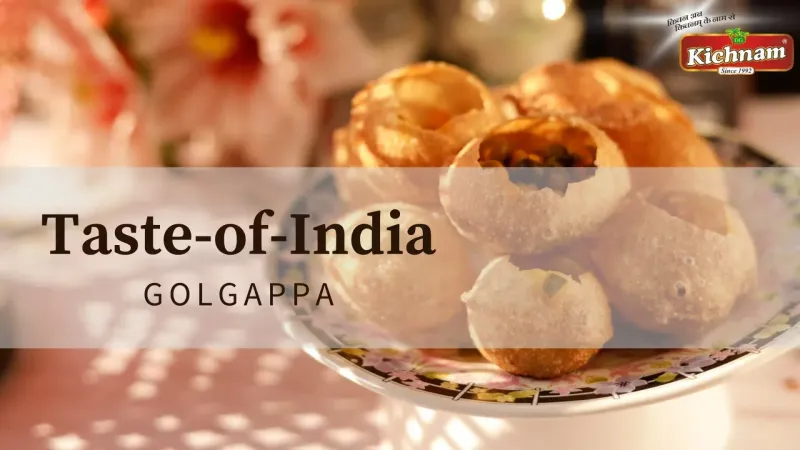
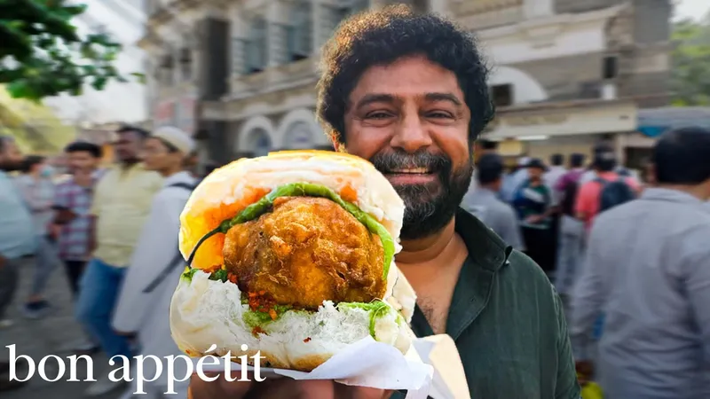
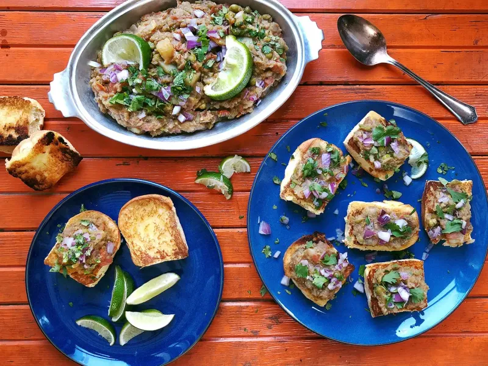
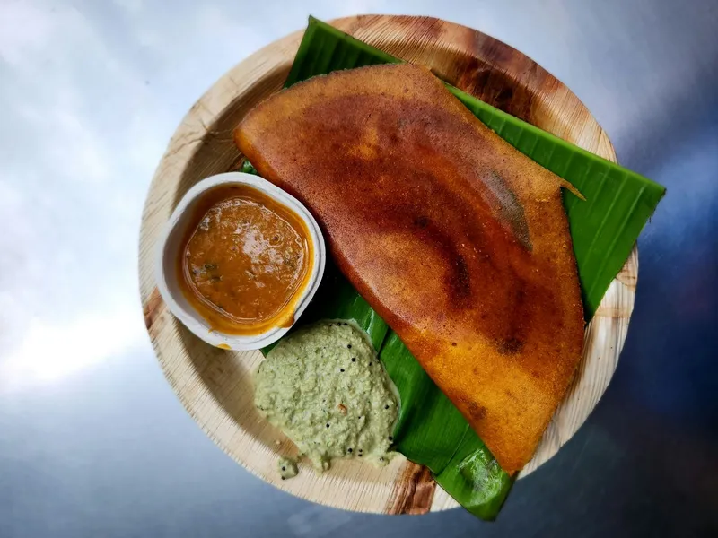
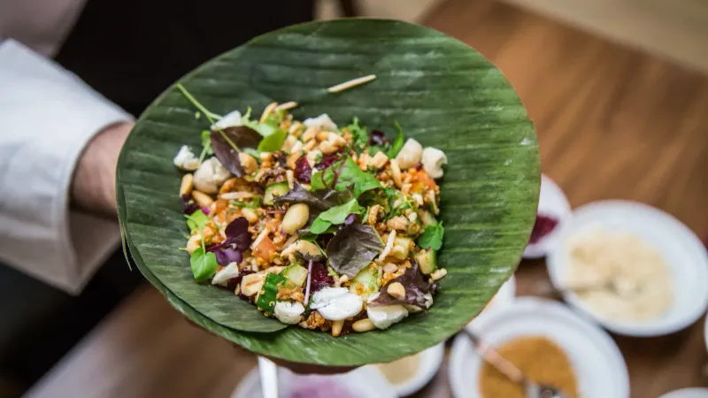
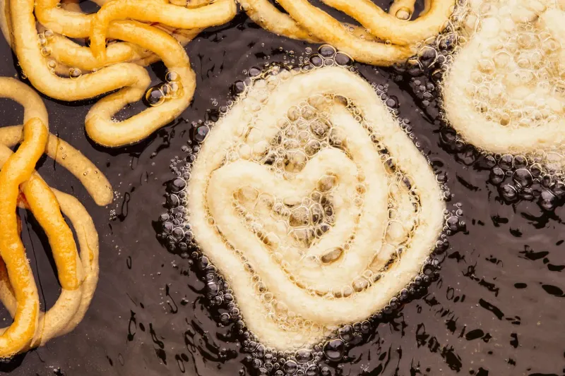

### 1. Пани Пури

Хрустящая оболочка мгновенно разлетается, высвобождая ароматизированную воду. Туристы часто давятся внезапным кислым-острым взрывом. Местные засекают время, съедая десятки быстро. Некоторые продавцы добавляют дополнительный порошок чили для дополнительных смехов.

### 2. Вада Пав

Жареная картофельная котлета, раздавленная в булочке с огненными чатни. Жар нарастает медленно, а потом бьет сильно. Съесть без капель масла почти невозможно. Ходят слухи, что зеленое чатни — настоящий тест на смелость.

### 3. Пав Бхаджи

Овощное пюре, утопающее в масле, подается с поджаренными булочками. Смесь специй оставляет пальцы окрашенными в оранжевый цвет на часы. Новички каждый раз недооценивают размер порции. Некоторые ларьки добавляют дополнительный сыр, отчего блюдо становится еще тяжелее.

### 4. Масала Доса

Гигантский хрустящий блин с пряной картошкой, который нужно рвать руками. Края могут порезать пальцы, если не быть осторожным. Кокосовое чатни охлаждает, а самбар обжигает. Уличные продавцы складывают его за секунды, оставляя новичков в недоумении.

### 5. Бхел Пури

Хаотичная смесь воздушного риса, севы и чатни, которую готовят прямо при вас. Она размокает за минуты, поэтому нужно есть быстро. Сладкий тамаринд и зеленый чили создают постоянный вкусовой шок. В дождливые дни все превращается в скользкий беспорядок.

### 6. Острый Джалеби

Горячие спирали в сиропе, подаваемые прямо из сковороды. Сладость резко сталкивается со спрятанными хлопьями чили в некоторых версиях. Обжечь язык почти гарантировано с первого кусочка. Уличные легенды гласят, что только местные могут доесть целую тарелку без воды.

