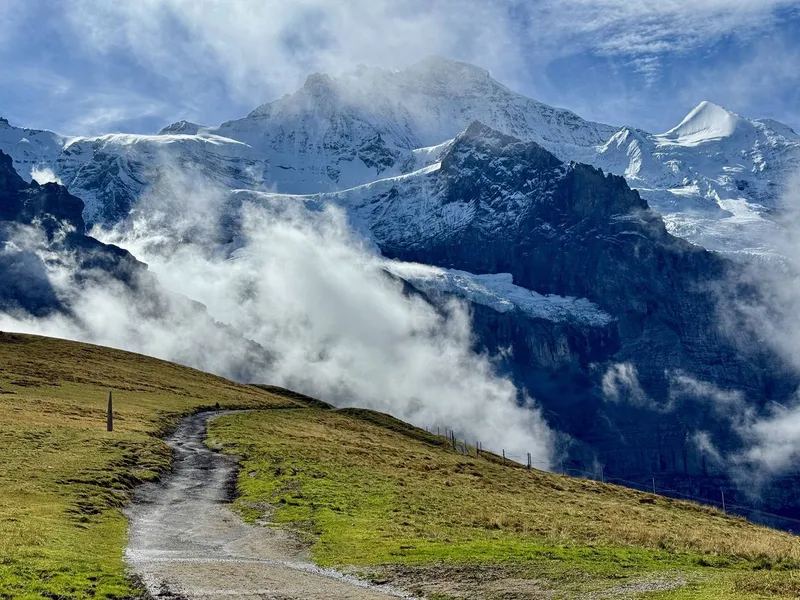
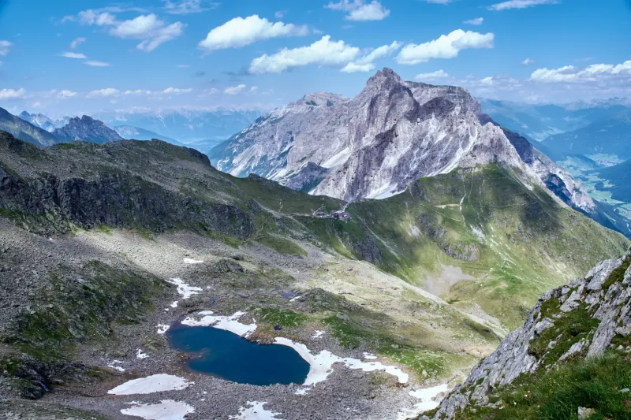
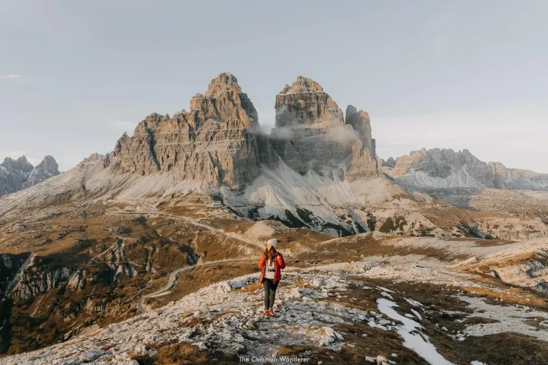
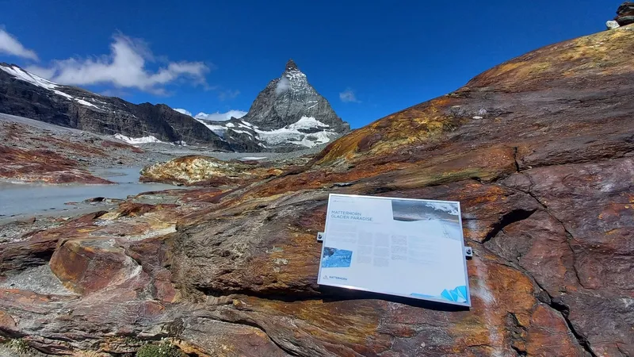
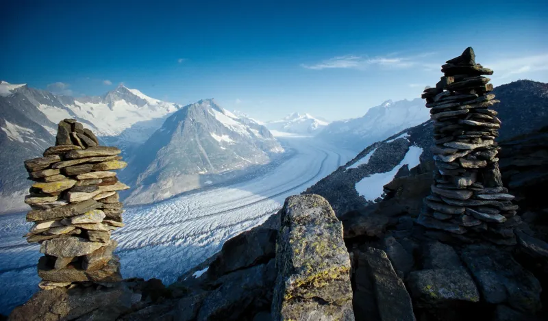
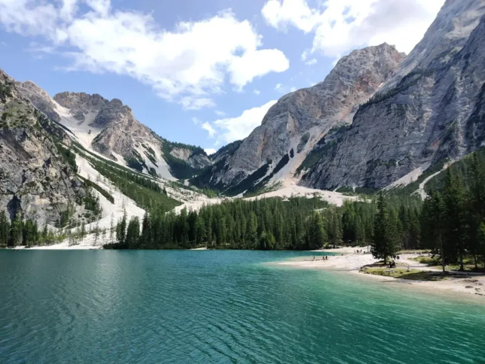
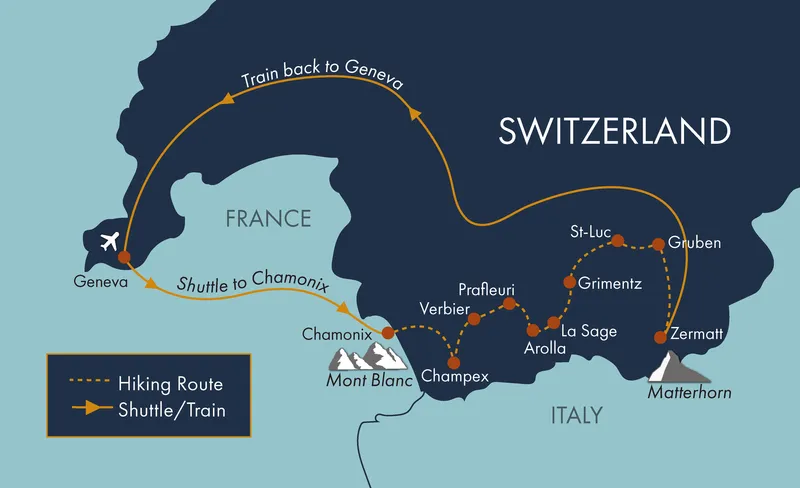
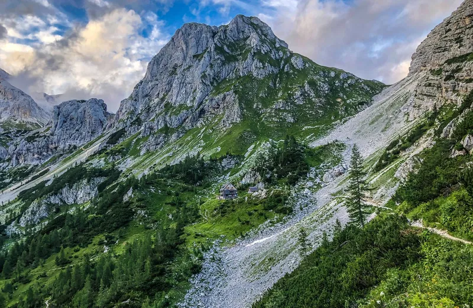
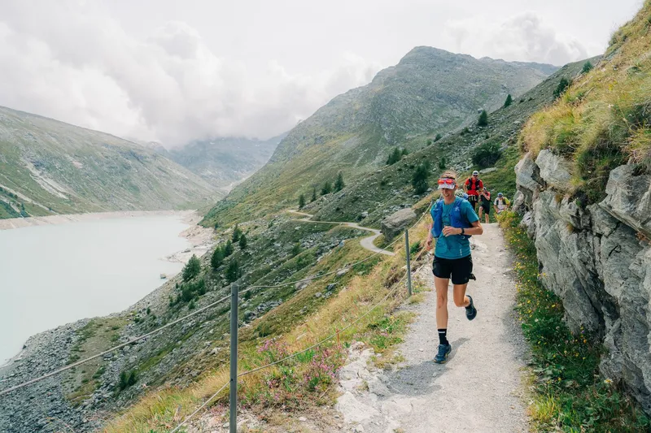
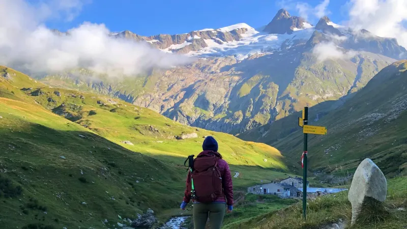

### 10. Eiger Yolu

Vadinin yükseklerinden başlarsınız ve kuzey yüzünün tabanı boyunca istikrarlı bir şekilde alçalır. Patika kayaya yakın kalır, böylece tüm yol boyunca duvarın ölçeğini hissedersiniz. Yazın kenarlarda yabani çiçekler sıralanır ve manzaralar doğrudan Mönch'e açılır.

### 9. Stubai Yüksek Yolu

Rota, bir dağ kulübeleri zinciri kullanarak Stubai vadisini çevreler. Her gün 2500 metrenin üzerindeki geçitleri geçersiniz ve ufukta buzullar görünür. Her gece farklı kulübelerde uyursunuz ve yemek tamamen yerel Avusturya alp mutfağıdır.

### 8. Tre Cime di Lavaredo Devresi

Üç yükselen kireçtaşı zirvesini geniş bir çakıl yol üzerinde, yürüyüşün çoğunda yüksek kalarak dolaşırsınız. Kaya ışıkla renk değiştirir ve kayalıklara oyulmuş birkaç I. Dünya Savaşı tünelini geçersiniz. Yan yollar kulelere yakından bakmak için tırmanmanıza olanak tanır.

### 7. Matterhorn Buzul Yolu

Yol sizi eski moren boyunca ve Zmutt Buzulu'nun kenarına kadar götürür. Matterhorn'un kuzey tarafının sürekli yakın manzaralarını elde edersiniz ve buzul dilinden buz düşüşünü izleyebilirsiniz. Son sırt yürüyüşü size Pennine Alpleri'nin tam 360 derecelik panoramasını verir.

### 6. Aletsch Panorama Yolu

Aletsch Buzulu'nun yanında uzunluğunun çoğunda düz kalan yüksek bir balkon yolunu takip edersiniz. Buz 20 kilometreden fazla aşağıda uzanır ve yol sonbaharda parlak altın rengi alan karaçam ormanlarından geçer. Birkaç teleferik farklı yüksekliklerde başlamanıza veya bitirmenize olanak tanır.

### 5. Alta Via 1

Bu uzun rota, bir dizi yüksek geçit ve sığınak kullanarak İtalyan Dolomiter'i kuzeyden güneye geçer. Soluk kaya platolarını geçer ve her akşam yeşil vadilere inersiniz. Rota, Cortina çevresindeki dişli zirvelerdeki gün batımı renkleriyle ünlüdür.

### 4. Yürüyüşçünün Haute Rotası

Fransa'dan İsviçre'ye iki ünlü kasaba arasındaki düzinelerce yüksek geçidi geçerek seyahat edersiniz. Her gün yeni buzul manzaraları ve kendi peynirleri ve şaraplarıyla farklı vadiler getirir. Zermatt'a son yaklaşım size Matterhorn'un doğudan ilk net görüntüsünü verir.

### 3. Triglav Geçişi

Yol sizi Julian Alpleri boyunca ve Triglav'ın zirvesine son açık sırt üzerinden götürür. En dik bölümlerde çelik kablolar kullanırsınız ve kayaya inşa edilmiş dağ kulübelerinde uyursunuz. Zirveden manzara net günlerde Adriyatik'e kadar ulaşır.

### 2. Monte Rosa Turu

Tüm Monte Rosa grubunu çoğunlukla 2000 metrenin üzerinde kalarak dolaşırsınız. Yol İsviçre ve İtalya arasında değişir ve Matterhorn'un doğu yüzünü alışılmadık bir açıdan geçer. Geceler, çevredeki 4000 metrelik zirvelerde alpenglow'u izleyebileceğiniz yüksek kulübelerde geçirilir.

### 1. Mont Blanc Turu

Rota Alpler'in en yüksek zirvesini çevreler ve Fransa, İtalya ve İsviçre'yi geçer. Mont Blanc'ın buzullarının sürekli manzaralarıyla bir düzineden fazla geçidi aşarsınız ve her günü farklı bir sığınakta bitirirsiniz. Chamonix'e son iniş sizi ilk gün gördüğünüz aynı kuzey yüzünün altına getirir.

